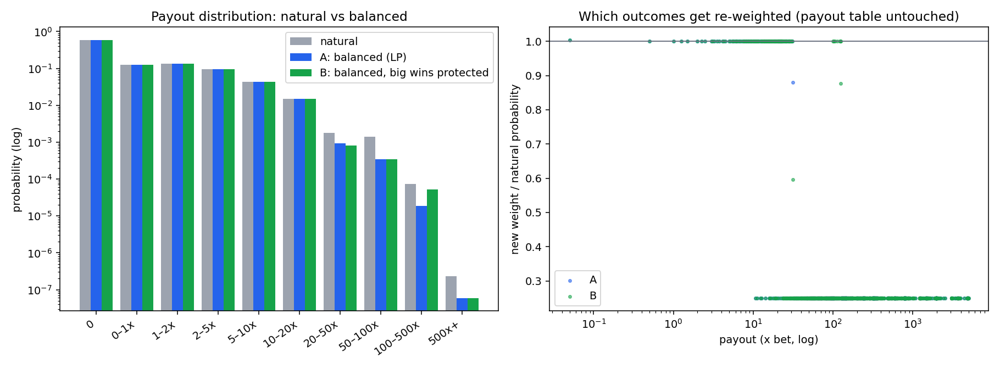
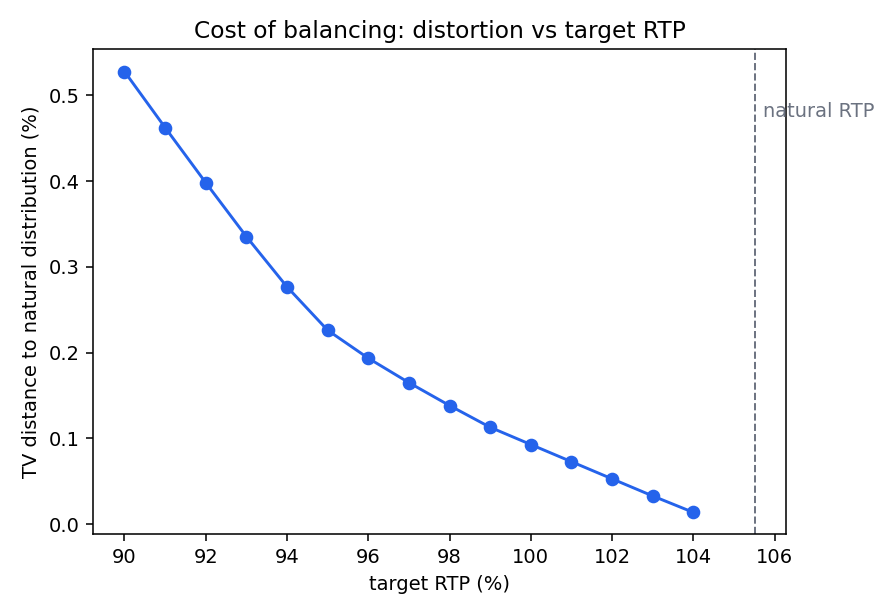

# 示範 01：RTP／波動率配平（線性規劃）

**問題**：自然 RTP 是 105.5%，目標 96%。要怎麼調？

**限制**：公布的賠付表不能動（動了，玩家畫面上的倍率與實付就對不起來）。所以能動的只有「每種結果被抽到的權重」。

## 方法

每個「結果原子」j 有固定賠付 x_j 與自然機率 p_j。解新機率 w：

```
minimize   TV(w, p) = ½ Σ |w_j − p_j|        離自然分布越近，機制被扭曲越少
subject to Σ w_j = 1,   w_j ≥ 0.25 · p_j      每個結果都保留，不刪結果
           Σ w_j x_j = 0.96                   目標 RTP
           0.30 ≤ 命中率 ≤ 0.45
           P(賠付 ≥ 100x) ≤ 1e-4
```

絕對值用輔助變數線性化，以 `scipy.optimize.linprog`（HiGHS）求解；最後換成正整數權重（總和 1e12，最大餘數法，每個結果至少 1）。

## 結果（`python run.py`）

| | RTP | 標準差 | 命中率 | P(≥100x) | 距自然分布 (TV) |
|---|---|---|---|---|---|
| 自然 | 105.512% | 3.496 | 41.45% | 7.38e-05 | — |
| **A** LP 配平 | 96.000% | 2.616 | 41.26% | 1.84e-05 | 0.194% |
| **B** LP 配平＋保護大獎 | 96.000% | 2.688 | 41.25% | 5.16e-05 | 0.203% |
| A 整數化後 | 96.000%（誤差 6.8e-07） | | | | |

賠付表全程不變（程式內以斷言守住）。



## 值得注意的發現

1. **「最便宜的調法」會砍大獎。** 降低 RTP 時，LP 每單位扭曲能減最多 RTP 的辦法，是把最大的賠付砍掉。右圖（藍點）可看到幾乎所有 ≥10x 的結果都被壓到下限（自然機率的 25%），中間幾乎沒動。結果是 100 倍以上的大獎頻率掉到約 1/4。數學上完全合規，但玩家會覺得大獎變得很難中。
2. **加一條限制式就能修。** 方案 B 要求 P(≥100x) ≥ 自然值的 70%：大獎頻率拿回 5.16e-05，扭曲只多 0.009 個百分點。**選方案時看體感，不只看是否達標。**
3. **目標 RTP 越低，代價越高，且可量化。**



## 限制

- 目標函數用 TV 距離是一種選擇；也可以改成相對熵、或對特定區間加權，結論會不同。
- 這個遊戲的原子是精確枚舉出來的；真實遊戲要用分層模擬估原子機率，需另外處理估計誤差（見示範 02）。
