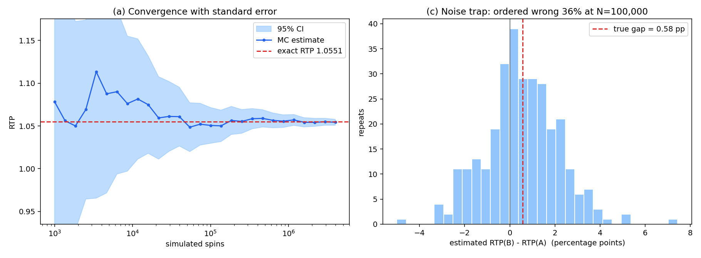

# 示範 02：Monte Carlo 的統計紀律

**核心主張**：模擬的數字**一律附標準誤**。重尾分布下，相鄰參數的差距常小於雜訊，
不附標準誤就拿來比較，會把雜訊當成趨勢。

因為這個虛構遊戲能精確枚舉，我們有標準答案（精確 RTP = 1.05512）可以對照。

## 三個實驗（`python run.py`，固定亂數種子，可重現）

**(a) 收斂**：模擬 400 萬次，RTP = 1.05433 ± 0.00345（95% CI），與精確值差 0.00079，落在區間內。用串流（Welford）累積，記憶體與模擬次數脫鉤。

**(b) 信賴區間覆蓋率**：重複 400 次（每次 2 萬轉），95% 信賴區間實際包到精確值 **94.0%**。
這是在驗證「我宣稱的區間可不可信」。注意：400 次重複本身有約 ±1 個百分點的抽樣誤差。

**(c) 雜訊陷阱**：把最高階符號的賠付 +8%，兩個遊戲的精確 RTP 差 **0.576 個百分點**。
每邊各模擬 10 萬次、重複 300 次：**有 36% 的重複把兩者排反**。

- 理論檢驗：差值標準誤 = σ√2/√N = 3.496×1.414/316 = 1.56 pp；z = 0.576/1.56 = 0.37；P(排反) = Φ(−0.37) ≈ 35.6%。與實驗 36% 一致。
- 要 95% 排對（單尾），每邊需 n = (1.645·σ·√2/δ)² ≈ **200 萬次**。

## 這代表什麼

- 「調參數 → 模擬 10 萬次 → 看哪個 RTP 高」在這個遊戲上，約三分之一的時間會得到錯誤結論。
- 看到「非單調」的結果（參數增加、RTP 卻下降）先懷疑雜訊，不要急著解釋機制。
- 能精確計算（枚舉、解析式）的部分就不要用模擬；模擬留給算不出來的部分。
