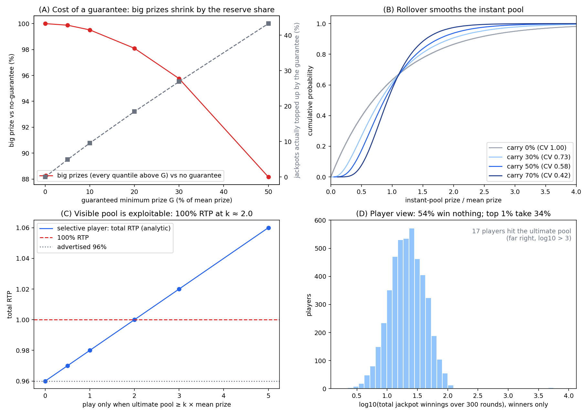

# 示範 04：樂透式 Jackpot 獎池設計與模擬

**情境**：一個沒有歷史資料的新玩法，要設計獎池結構，並在上線前用模擬回答
「會怎麼派獎？保底值不值得？玩家看得到獎池會不會被利用？」

> 虛構玩法與參數，不含任何公司細節。每注 = 1，獎金為「幾倍投注」。

## 結構

| 獎池 | 每注提撥 | 命中機率 | 命中後 | 平均獎金 |
|---|---|---|---|---|
| 即時獎共池 | 4% | 1/500 | 派出 50%，**50% 滾入下一期** | 20 倍 |
| 終極彩池 | 2% | 1/200,000 | 全額派出、歸零 | 4,000 倍 |

基礎遊戲 RTP 90% ＋ 兩個獎池 6% ＝ 整體 96%。

## 模型與可檢驗的性質

兩次命中之間的投注數 K 服從**幾何分布**，所以很多結果有解析解，可以拿來檢驗模擬：

1. **守恆**：長期平均每次命中的獎金 = c/p ＋ 基礎獎金（進去多少、最終就派出多少）。
2. **無記憶性**：隨機一注當下的獎池大小，與「命中那一刻的獎池」同分布。這是第 C 項風險的來源。
3. 逐注模擬的**帳目恆等式**：派出 ＋ 剩餘餘額 ＝ 全部提撥（一分不差，有測試）。

事件驅動的模擬（只模擬命中）與逐注模擬的獎金分布一致（變異係數都是 0.572）。

## 結果（`python run.py`，固定種子）

### A. 保底的取捨（終極池）

「保底 G」：命中時獎金 ＝ max(餘額, G)。差額由「準備金」補，準備金從每注提撥中抽一個比例 s，其餘 (1−s) 才進獎池。
求最小的 s 使準備金平均而言剛好付得起（精確加總解出，並用蒙地卡羅獨立檢查：G=10% 時短缺 19.41、準備金進帳 19.44）。

| 保底 G（占平均獎金） | 準備金抽成 s | 保底實際被用到 | 中位獎金 | P99 | 大獎相對無保底 |
|---|---|---|---|---|---|
| 0 | 0% | — | 2,773 | 18,421 | 100% |
| 10% | 0.49% | 9.6% | 2,759 | 18,331 | 99.5% |
| 30% | 4.24% | 26.9% | 2,655 | 17,639 | 95.8% |
| 50% | 11.84% | 43.3% | 2,444 | 16,240 | 88.2% |

- **「設保底會壓縮最大獎」是真的，但小保底的代價很小**：保底 10% 只讓大獎縮 0.5%，而且平均獎金不變（只是重新分配，已驗證）。到 50% 才縮 12%。
- 另一條路是營運方出**基礎獎金**：S=100 倍時，無 seed 會有 2.5% 的獎金低於 100 倍；營運成本 0.05 個百分點 RTP。

### B. 即時池「滾存」讓獎金更穩

| 滾存比例 | 變異係數 CV | 獎金 < ¼ 平均的機率 | P99 / 平均 |
|---|---|---|---|
| 0% | 1.00 | 22.0% | 4.60 |
| 30% | 0.73 | 7.0% | 3.55 |
| 50% | 0.58 | 2.0% | 2.92 |
| 70% | 0.42 | 0.2% | 2.30 |

平均獎金不變（20 倍，守恆）。滾存讓「剛有人中獎、池子被清空、下一個中獎者只拿到一點點」變少。

### C. ⚠️ 設計風險：玩家看得到獎池，就能挑時機玩

若命中機率固定、獎池可見，只在餘額 ≥ k × 平均獎金時才下注的玩家，獎池部分 RTP 是一般玩家的 (1+k) 倍（解析解）：

| k | 終極池 RTP | 該玩家整體 RTP |
|---|---|---|
| 0（照常玩） | 2.0% | 96% |
| 1 | 4.0% | 98% |
| **2** | 6.0% | **100%** |
| 3 | 8.0% | 102% |
| 5 | 12.0% | 106% |

**k≈2 時整體 RTP 就破 100%**（獎池 ≥ 8,000 倍、約 13.5% 的時間），這個玩家對營運方是穩賺的。
這是「廣告 RTP 96%」只對平均玩家成立的例子。可能的緩解（本示範未模擬）：命中機率隨獎池調整、隱藏即時餘額、限制單人投注量。

驗證：解析公式與「對幾何分布直接加總」誤差 < 0.2%（測試）；與逐注模擬（p 放大成 1/500）在 k≤3 差 0.9–1.7%，
k=5 差 6%——這**不是公式錯**，而是 k=5 只有約 27 個獨立週期（4,000 次命中 × e⁻⁵），模擬本身雜訊大。

### D. 兩種視角：1 萬位玩家 × 300 局（300 萬注）

| | 數值 |
|---|---|
| 系統：終極池中獎人數 | 期望 15，模擬 17 |
| 系統：即時池中獎次數 | 期望 6,000 |
| 單一玩家：300 局至少中一次即時獎 | 理論 45.15%，模擬 45.76% |
| 單一玩家：300 局至少中一次終極獎 | 理論 0.150%，模擬 0.17% |
| 完全沒中任何獎池獎 | 54% |
| 中位數／P90／P99 獎金 | 0／37.0／78.5 倍 |
| 前 1% 的玩家拿走全部獎池獎金 | 34.4% |

**單次模擬的雜訊很大**：這一次模擬的獎池 RTP 是 5.70%（理論 6.00%）。重複 40 次：
即時池 4.02%（標準差 0.06 個百分點）、終極池 1.89%（標準差 **0.54**）。
單次 300 萬注的模擬，連「5.7% 還是 6.0%」都分不清——終極池每次只有十幾個中獎者（呼應[示範 02](../02_monte_carlo_discipline/)）。

## 值得記住的統計細節

- **滾存讓相鄰獎金相關**（連續兩次獎金正相關），一般標準誤會低估不確定性。我一開始就是這樣誤判「模擬有偏差」，後來發現是相關性造成，測試改用**分塊平均標準誤**。
- 極稀有的獎池，在合理的模擬量下**根本估不準**；能用解析解就不要用模擬。

## 限制

- 假設各注獨立、玩家同質、獎池全額派出；未模擬同一時刻多人同時命中。
- 保底準備金只保證「平均而言」自給自足；有限期間內可能短缺，需要營運方墊底（未模擬）。
- 玩家視角的獎金從穩態樣本中獨立抽取，是近似。
